  

  
  
  

  

 

I'm a **Computer Science undergraduate at Amrita Vishwa Vidyapeetham** who builds software end-to-end, from database schema and API design to the interface people actually click.

My focus is where **AI meets real engineering**. I don't wrap an LLM in a text box. I design systems where models reason over *verified* data: agents that cross-check claims against live GitHub activity, NLP pipelines that rank candidates by meaning instead of keywords, and platforms that treat security as architecture, not an afterthought.

  

 

    
    
    
  

  
  
  
  
  

 

  
  

  
  

  
  

<b>📂 More projects</b>

 

| Project | Description | Stack |
|---|---|---|
| [**Game-Verse**](https://github.com/Vimaladharsan/Game-Verse) | Steam-inspired game store with data-driven detail pages, search and categories | HTML · CSS · JavaScript |
| [**Student Management System**](https://github.com/Vimaladharsan/student-management-system) | Desktop app for students, courses, marks and attendance with a clean DAO layer | Python · Tkinter · MariaDB |
| [**Loopy Solver**](https://github.com/Vimaladharsan/Loopy_SimonTatham_Games) | Slitherlink puzzle logic with graph, greedy and sorting algorithm implementations | Python · DAA |

 

  

 

  

 

  

  <picture>
    <source media="(prefers-color-scheme: dark)" srcset="https://raw.githubusercontent.com/Vimaladharsan/Vimaladharsan/output/github-contribution-grid-snake-dark.svg" />
    
  </picture>

 

  

